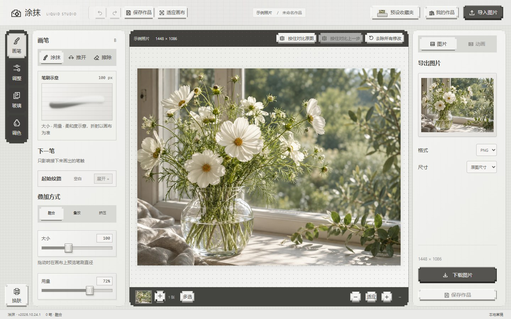
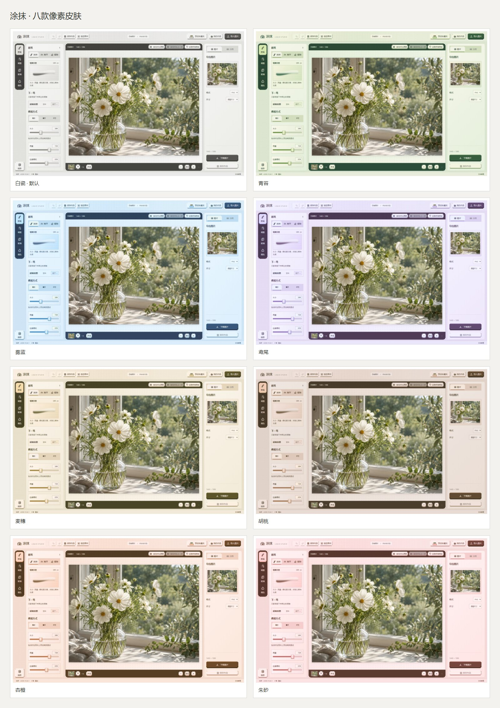
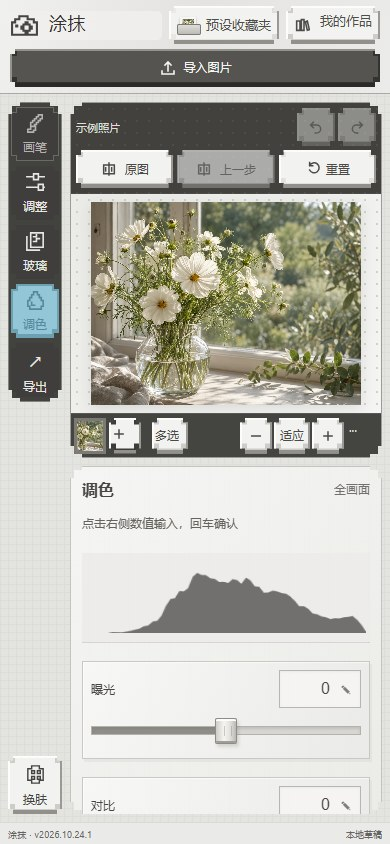

# 涂抹 · Liquid Studio

**在浏览器里，把照片变成流动的光。**

一款以玻璃折射和液体笔触为核心的图片创作工具。支持分层涂抹、推开、擦除、实时调色和图片 / 动画导出，采用阶梯式像素圆角与细格底纹，提供八款浅色皮肤。图片处理在用户设备上完成，无需注册，也不需要图像处理后端。

[在线体验](https://hajimi-tomato.github.io/liquid-studio-mint/) · [使用指南](docs/USER_GUIDE.md) · [本地运行](#本地运行) · [界面设计](docs/DESIGN.md) · [实现架构](docs/ARCHITECTURE.md)

[](https://github.com/hajimi-tomato/liquid-studio-mint/actions/workflows/checks.yml)



> 当前界面版本：`v2026.10.24.1`。截图来自真实工作台；历史版本网址会跳转至当前入口。参见 [更新日志](CHANGELOG.md)。

## 可以做什么

| 能力 | 当前实现 |
| --- | --- |
| 液体笔触 | 涂抹、推开、擦除；可调整大小、用量和边缘柔和度 |
| 分层编辑 | 融合、叠放、挤压三种涂抹方式；上层或全部层擦除 |
| 材质与光线 | 玻璃着色、平滑 / 长虹 / 水纹表面，以及折射、光泽、柔化和光感调节 |
| 调色与对比 | 曝光、对比度、饱和度、色温、色相；滑块与数值输入；按住对比原图或上一步 |
| 多图工作区 | 多张图片独立编辑；多选套用当前效果；批量导出 ZIP |
| 本地保存 | 在当前浏览器保存原图、笔画图层和参数；自动草稿可主动恢复 |
| 导出 | PNG / JPG；循环 GIF；浏览器支持时导出 MP4 或 WebM |
| 手机布局 | 竖屏保留画布、参数区独立滚动；横屏紧凑布局；触摸涂抹与双指缩放 |
| 八色皮肤 | 默认白瓷；可切换绿色、蓝色、紫色、黄色、棕色、橙色与红色；选择保存在当前浏览器 |

### 八款像素皮肤

点击工作台左下角的「换肤」，选择白瓷、青苔、雾蓝、鸢尾、麦穗、胡桃、杏橙或朱砂。面板、按钮、滑块、笔刷示意和直方图随皮肤一起调整；照片、真实材质和导出结果保持原色。也可以按 `Esc` 关闭选择面板。



### 从一张照片开始

1. 打开工作台，使用示例照片，或点击「导入图片」选择 PNG、JPG、WebP。
2. 选择「画笔」，直接涂抹；也可以先从「预设收藏夹」应用一种效果，再继续编辑。
3. 用「调整」修改已有笔触，用「玻璃」和「调色」处理整体画面。
4. 点击「导出」下载图片或动画；需要继续编辑时，另外点击「保存作品」。

**保存作品与下载成品是两件事。**「我的作品」保存在当前浏览器，不跨设备同步；PNG、JPG、GIF 和视频是成品文件，不包含可继续编辑的图层。清理网站数据可能移除本地作品。

### 真实效果示例

下图使用工作台的预设、参数调节和手动笔触生成，未使用额外修图程序加工。

| 原图 | 玻璃折射与液体笔触 |
| --- | --- |
|  |  |

<details>
<summary>查看手机界面</summary>

<p></p>

手机布局已通过 Chromium 触摸模拟检查；iPhone Safari、微信内置浏览器和低端手机仍需真机验证。详情见 [兼容性与限制](docs/USER_GUIDE.md)。

</details>

## 本地运行

网站本身没有构建步骤。安装 Python 3 后，在仓库目录运行：

```bash
git clone https://github.com/hajimi-tomato/liquid-studio-mint.git
cd liquid-studio-mint
python -m http.server 8000 --bind 127.0.0.1 --directory dist
```

打开 **http://127.0.0.1:8000/**。部分系统使用 `python3` 命令。

请通过 HTTP 服务打开；直接双击 HTML 文件可能影响 ES 模块、Worker 和本地存储。普通使用者只需要支持 WebGL 的浏览器，**不需要安装 Node.js**。

## 开发与验证

开发测试使用 Node.js 22 和 Python 3：

```bash
npm ci
npm run check:docs
npm test
npm run test:e2e
```

本地端到端测试默认使用已安装的 Microsoft Edge。使用 Playwright 自带 Chromium 的方式见 [贡献指南](CONTRIBUTING.md)。GitHub Actions 会检查文档链接、运行单元测试和浏览器测试，徽章展示实际执行结果。

2026-10-24 的本地验证覆盖 31 项单元测试和 23 项浏览器测试，包括独立笔画、擦除、撤销、本地保存、批量导出、手机触摸及八款皮肤切换后画面保持不变。测试通过不代表所有手机硬件均已验证。

## 项目结构

```text
dist/                   可直接部署的完整静态网站
  app.js                工作区状态、手势、历史、导入与导出
  stroke-layers.js       不可变笔画文档与编辑事务
  liquid-renderer.js     WebGL 合成与调色
  recording.js          动画预览、录制与导出
  draft.js              本地自动草稿
  mobile-workspace.*    手机布局与触控入口
  assets/               随站点提供的图片素材
  vendor/               GIF 编码依赖及其许可证
docs/                   使用、设计、架构与部署说明
e2e/                    Playwright 浏览器测试
tests/                  Node.js 单元测试
scripts/                截图与文档检查工具
```

## 设计与实现

- **功能优先的像素界面**：阶梯式圆角、八款克制的浅色皮肤、轻拟物滑块；交互反馈与实际参数变化对应。
- **浏览器本地处理**：WebGL 渲染、IndexedDB 保存和本地文件下载。网站仍需加载静态资源，当前没有云端作品库。
- **分层合成**：笔画事务生成有序图层，经玻璃底图、逐层折射与最终调色得到画面。这是视觉近似，不是流体物理模拟。

深入阅读：[界面设计规范](docs/DESIGN.md) · [实现架构](docs/ARCHITECTURE.md) · [部署说明](docs/DEPLOYMENT.md)

## 当前边界与下一步

- 手机真机兼容性、大图和长动画的内存占用仍需进一步验证。
- 当前界面尚无完整工程文件的导入 / 导出入口；本地作品不等于云端备份。
- 当前公开入口托管于 GitHub Pages，国内独立域名与托管迁移尚未完成。
- 示例素材由图像生成工具制作；工作台本身尚未集成 AI 生图服务。

## 反馈、素材与许可

遇到问题请提交 [Bug 报告](https://github.com/hajimi-tomato/liquid-studio-mint/issues/new?template=bug_report.yml)，附上复现步骤、浏览器和屏幕尺寸。欢迎通过 [贡献指南](CONTRIBUTING.md) 提交改进。

示例图片与界面美术包含使用 OpenAI 图像生成工具制作的素材。GIF 编码使用 [gifenc](https://github.com/mattdesl/gifenc)，其 MIT 许可证保留在 [第三方许可文件](dist/vendor/gifenc.LICENSE) 中。项目级许可证尚未确定，使用或分发本项目代码与素材前，请与维护者确认授权范围。
