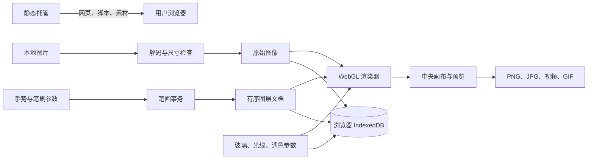

# 实现架构

[返回项目首页](../README.md)

本文描述当前代码，不将计划功能作为已实现能力。

## 运行边界

项目是 HTML、CSS 和原生 JavaScript ES 模块组成的静态应用。静态托管服务分发程序与素材，用户浏览器负责解码、编辑、渲染、保存和导出。目前没有登录服务、图片上传 API、云端数据库或 AI 生图 API。

GIF 编码依赖随站点提供的 gifenc，由 Web Worker 执行。除此之外不需要从外部 CDN 加载编辑器框架或字体。Node.js 与 Playwright 仅用于开发测试。

## 状态与笔画

[`stroke-layers.js`](../dist/stroke-layers.js) 维护图层文档与事务。已提交的图层及其数组按只读约定使用，修改会生成新的图层对象；预览与历史可以共享未改变的数据。

每层保存裁剪区域中的厚度和方向场，而不是一张完整彩色图片。场网格的最长边为 640，文档校验限制最多 256 层和 128 MiB 图层数据。这些是数据层边界，不是手机可稳定处理的容量承诺。

融合、独立叠放、挤压、推开和两种擦除模式均复用编辑事务。一次有效笔画开始修改时记录历史；历史最多保留 25 个快照。双指缩放会取消本次尚未完成的触笔，恢复对应历史状态，避免将缩放手势保存成笔画。

## 渲染管线

[`liquid-renderer.js`](../dist/liquid-renderer.js) 使用 WebGL 1：

1. 将原图作为纹理，渲染整体玻璃表面。
2. 根据笔画场的厚度、梯度和方向，逐层计算折射、模糊与高光。
3. 通过两张离屏纹理交替读写合成笔画，并缓存可复用的底部图层。
4. 最后统一应用曝光、对比度、饱和度、色相和色温。

效果属于交互视觉近似；不求解真实流体，也不声称物理精确折射。640 级笔画场与原图尺寸是不同概念：笔画场较小，不代表图片按 640 像素导出。

编辑预览最长边限制为 1536，右侧预览进一步缩小；图片导出按用户选择的输出尺寸重新渲染。输入图像受 24 MP、设备最大纹理尺寸与 8192 边长上限约束。渲染器另有内存预算检查，不能据此保证低内存设备都可处理上限尺寸。

## 模块职责

| 文件 | 职责 |
| --- | --- |
| [`app.js`](../dist/app.js) | 工作区、输入、手势、状态、历史、作品库、预设、批量处理与图片导出 |
| [`stroke-layers.js`](../dist/stroke-layers.js) | 文档校验、事务、涂抹、挤压、推开、擦除与重采样 |
| [`liquid-renderer.js`](../dist/liquid-renderer.js) | WebGL 程序、纹理、分层缓存、最终调色与渲染 |
| [`brush-textures.js`](../dist/brush-textures.js) | 笔刷纹理沉积 |
| [`aloe-preset.js`](../dist/aloe-preset.js)、[`looks.js`](../dist/looks.js) | 内置预设的场数据与参数 |
| [`recording.js`](../dist/recording.js)、[`gif-worker.js`](../dist/gif-worker.js) | 动画预览、录制、编码、取消与下载 |
| [`draft.js`](../dist/draft.js) | 自动草稿、恢复入口与 IndexedDB 事务 |
| [`studio-ui.js`](../dist/studio-ui.js) | 功能面板、参数作用范围和中央动画预览的界面绑定 |
| [`detail-pass.js`](../dist/detail-pass.js) | 数值输入、展开项、笔刷示意与材质快捷设置 |
| [`pixel-v2.js`](../dist/pixel-v2.js) | 参数可视化、真实玻璃预览与像素图标覆盖 |
| [`mobile-workspace.js`](../dist/mobile-workspace.js) | 复用真实撤销 / 重做控件，适配手机操作入口 |

## 本地持久化

- `liquid-studio-presets`：作品记录，包含原图 Blob、缩略图、设置和图层。当前 v2 记录逐层保存，仍兼容旧版 v1 场数据。
- `liquid-studio-draft`：自动工作区草稿与可主动恢复的旧草稿。
- `localStorage`：少量界面偏好，例如图片 / 动画导出页签。

IndexedDB 按站点来源隔离；更换域名不会自动迁移旧作品。当前没有用户可操作的完整工程文件备份通道。PNG、JPG 与动画文件均为渲染结果。

## 现有技术债

界面经历多轮迭代，CSS / JavaScript 展示层存在顺序覆盖，并非完全由统一 token 驱动。设计文档标注了最终样式入口；维护时不要只修改基础变量后便假定所有组件已更新。

后续可逐步合并展示层、提供可移植工程格式，并补充真实移动设备的性能与兼容性验证。以上属于待办，不是当前功能。
